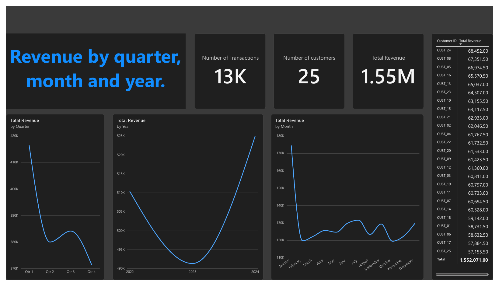
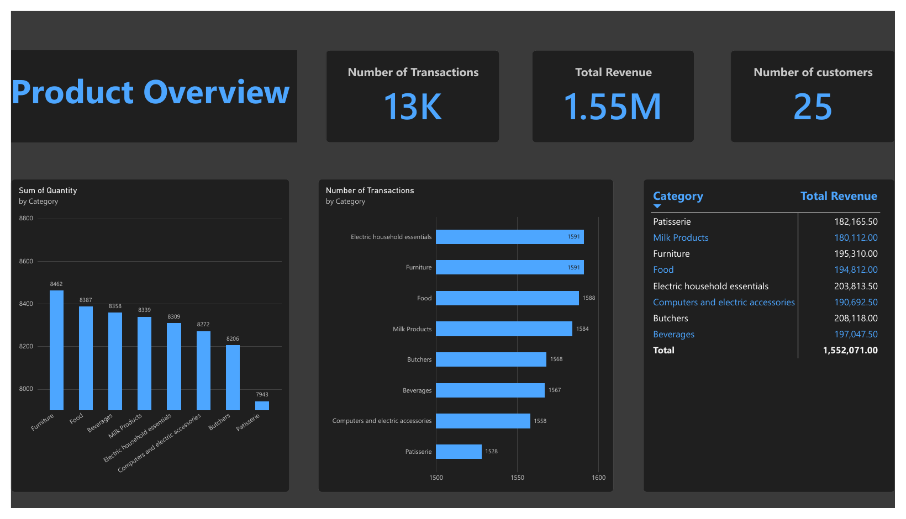
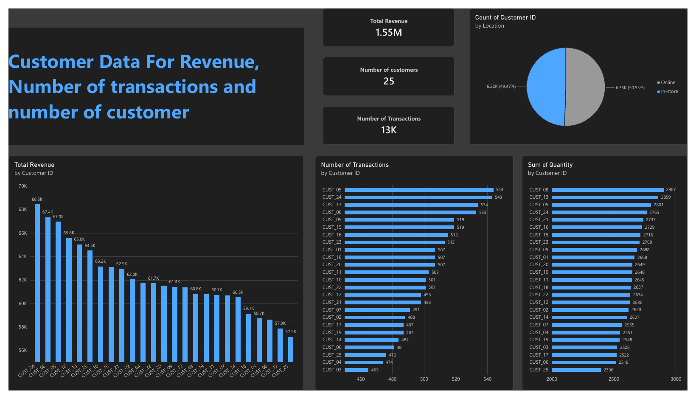
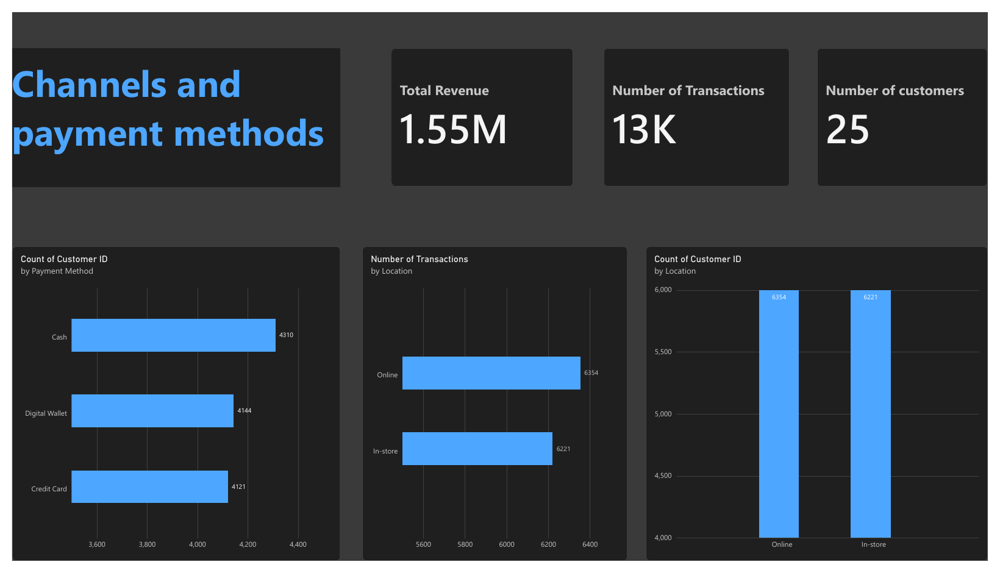

# Premium Items, Half the Revenue: A Retail Product Performance Review By Natasha Chipyoka

A business analysis of 12,575 retail transactions (January 2022 to 18 January 2025): which products make the money, when, and what a retailer should do about it. Built with Python (cleaning) and Power BI (dashboard), with a written client-style report.

**Read the report:** [`report/Premium_Items_Half_the_Revenue_Report.pdf`](report/Premium_Items_Half_the_Revenue_Report.pdf) (5 pages)
**Dashboard export:** [`report/Power_BI_Dashboard_Export.pdf`](report/Power_BI_Dashboard_Export.pdf)

---

## The question

Which products earn the most, when does the money come in, and where should the business focus?

## Key findings

| Finding | Evidence |
|---|---|
| **Items priced above $30 earn about half the revenue** | 49% of revenue from 32% of transactions. Items priced $5-$10 are 14% of transactions but 4% of revenue |
| **Category revenue follows price, not volume** | Categories rank for revenue in exactly the order of their average price per unit. Units sold sit within 3% across seven categories |
| **January is the peak month** | 10-24% above an average month in each of 2022, 2023 and 2024 (17% overall). February and October are weakest |
| **Revenue is evenly spread** | Online 51% / in-store 49%; no customer above 4.4% of revenue |
| **One category to watch** | Butchers is the top earner but fell 17% from 2022 to 2024 |

**Recommendations:** feature and protect the premium-priced items; plan the biggest promotions for January and test promotions in the weakest months; review the cheapest items; investigate the Butchers decline.

## Dashboard






## How the data was cleaned

Source: the public [Kaggle](https://www.kaggle.com) "retail store sales" dataset (`retail_store_sales.csv`). **No rows were deleted.**

| Issue | Rows | Fix |
|---|---|---|
| Item missing | 1,213 | Rebuilt from price + category (each item has one fixed price; each category has its own item code) |
| Price per unit missing | 609 | Rebuilt from the item, or from total / quantity |
| Quantity and total both missing | 604 | Not recoverable. Kept for counts, excluded from revenue |
| Discount flag missing | 4,199 | Labelled "Unknown", not guessed |

Checks: price x quantity equals total on every complete row; transaction IDs are unique. Revenue figures use the 11,971 transactions that have a total ($1,552,071).

## Limitations

- Each item has one fixed price, so the data cannot show how demand reacts to price changes.
- The discount flag never changes spend (total always equals price x quantity), so discount effects cannot be assessed.
- 2025 holds only 18 days and is left out of year and month comparisons.
- Item names are anonymous (for example "Item 25 in Furniture").
- Results are unusually even across channels, payment methods, customers and categories, which suggests the data may be synthetic. Treat the findings as a worked example of the method.

## Reproduce it

1. Download `retail_store_sales.csv` from Kaggle (the raw data is not stored in this repo).
2. Run the cleaning script:
   ```
   pip install pandas
   python src/clean_data.py retail_store_sales.csv retail_store_sales_clean.csv
   ```
3. Load the cleaned file into Power BI. Use `SUM('Total Spent')` for revenue and divide by the count of rows that have a total for average sale.

## Repository layout

```
retail-sales-performance-analysis/
├── README.md
├── report/   # Written report and dashboard export (PDF)
├── images/   # Dashboard page screenshots
├── src/      # clean_data.py
```
